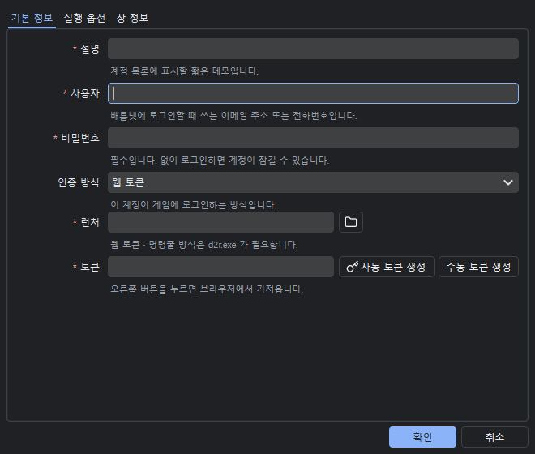
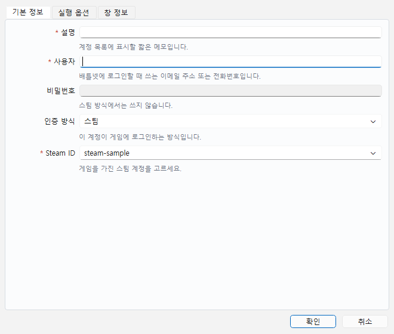

# 계정 관리

## 계정 등록

계정 생성이나 사이드 패널에서 계정 정보를 입력하고 등록합니다.



### 필수 입력 항목

계정 창은 탭 세 장(**기본 정보 / 실행 옵션 / 창 정보**)으로 나뉩니다. 아래는 **기본 정보** 탭입니다.

|항목|설명|
|------|------|
|설명|계정 목록과 창 제목에 표시할 짧은 메모입니다.|
|사용자|배틀넷 로그인에 쓰는 **이메일 주소 또는 휴대전화번호**입니다.<BR>전화번호는 적은 그대로 저장되므로 표기를 섞지 마세요(`010-1234-5678` ≠ `01012345678`).|
|비밀번호|배틀넷 계정 비밀번호입니다.<BR>잘못 입력하면 계정 잠김이나 CAPTCHA가 걸리므로 정확히 입력하세요. **비워 두면 계정이 잠길 수 있습니다.**|
|런처|`d2r.exe` 또는 `Diablo II Resurrected Launcher.exe` 경로입니다.<BR>스팀 방식에서는 이 칸 대신 **Steam ID** 칸이 나옵니다.|

!!! note "필수 표시(*)는 인증 방식에 따라 달라집니다"
    토큰은 웹 토큰일 때만, 런처는 스팀이 아닐 때만 필수입니다. 입력에 문제가 있으면 **그 칸 바로 아래 한 줄**로 알려 주고, 다른 탭의 오류는 탭 제목에 ● 표시가 붙습니다.

### 선택 입력 항목

| 항목 | 설명 |
|------|------|
| 모드 | 사용할 모드(mod) 이름입니다. **도구 > 모드/스킨 관리자**로 설치한 것이 목록에 나옵니다.|
| 설정파일 | 클라이언트별 설정파일(Settings.json)입니다. 계정별로 다르게 지정할 설정할 수 있습니다.<BR> **Settings**로 시작 **.json** 으로 끝나도록 저장해서 사용합니다.<BR>예) **Settings_메인.json**, **Settings_서브.json**|
| 전리품 필터 | 계정별 `lootfilter_*.json` 입니다. |
| 키/조작 파일 | 이 계정에 묶을 캐릭터를 고릅니다. 실행할 때 게임 폴더에 **없는 파일만** 스냅샷에서 복원합니다. |
| 실행 후 스크립트 | 게임 창이 뜨면 자동으로 실행할 스크립트입니다. |
| 창 정보 | 이 계정의 창을 띄울 위치·크기입니다(**창 정보** 탭). |

### 버튼

- **확인**: 새 계정 추가 또는 선택된 계정 정보 수정합니다. <BR>**최종 반영을 위해서는 파일 → 저장이 필요합니다.**
- **취소**: 계정 생성 및 수정 창을 닫습니다.

## 인증 방식

!!! tip "어떤 방식을 쓸까요? — **웹 토큰 방식**을 권장합니다"
    네 가지 중 **웹 토큰 방식**이 가장 안전하고 제약이 적습니다.

    | | 웹 토큰 | 명령줄 | 배틀넷 런처 | 스팀 |
    |---|---|---|---|---|
    |비밀번호가 프로세스 목록에 보임|아니오|**예**|아니오|아니오|
    |OTP(인증기) 계정|가능|불가|가능|가능|
    |런처 업데이트에 영향받음|없음|없음|적음|없음|

    처음에 토큰을 발급하는 단계가 한 번 더 있지만, 한 번 발급하면 다시 발급할
    때까지 계속 사용할 수 있습니다. 발급 방법은 아래 **토큰 발급** 절을 참고하세요.

### 명령줄 방식

가장 간단한 인증 방식입니다. 다만 **디아블로2 시절부터 있던 옛 경로**라 블리자드가 통째로 끌 수 있고, 실제로 2023년에 아시아 서버에 대해 모든 사용자가 막힌 적이 있습니다(이후 복구). 접속 문제가 반복되면 같은 계정을 **웹 토큰 방식으로 바꿔** 시험해 보세요.

```
    d2r.exe -username abc@abc.net -password mypassword
```

!!! warning "제한사항"
    - ~~아시아(한국) 서버는 2023년 10월부터 **차단**됨~~ 다시 복구되었습니다.
    - OTP(인증기) 사용 계정은 **사용불가**입니다.
    - **비밀번호가 실행 인자로 전달됩니다.** 게임이 실행되는 동안 같은 사용자로
      실행되는 다른 프로그램(작업 관리자 등)이 비밀번호를 읽을 수 있습니다.
      이 점이 신경 쓰이면 **웹 토큰 방식**을 사용하세요 — 토큰은 암호화되어
      레지스트리로 전달되므로 실행 인자에 비밀 값이 들어가지 않습니다.

### 웹 토큰 방식

토큰을 발급받아 인증하는 방식입니다.

!!! success "장점"
    - 아시아 서버 접속 가능합니다.
    - OTP 사용 계정 지원합니다.
    - 한 번 발급 후 다시 발급할 때 까지 계속 사용 가능합니다.

### 배틀넷 런처 방식

배틀넷 런처를 띄워 아이디·비밀번호를 대신 입력하고 실행합니다.

!!! warning "계정마다 D2R 폴더 경로를 따로 둬야 합니다"
    배틀넷 런처는 **자기 설치 폴더의 파일로** 게임을 띄웁니다. 그 폴더로 D2R이 이미 하나라도 돌고 있으면, **그 클라이언트를 어떤 방식으로 띄웠든** 런처는 새로 띄우지 못합니다.

    동시에 띄울 개수만큼 폴더 경로를 따로 만들고, 계정마다 **런처** 경로를 각자의 폴더 안쪽으로 지정하세요.

    **정션(Junction)이면 충분합니다.** 런처는 경로를 기준으로 판단하므로 수십 GB를 복사할 필요가 없습니다.

    **실행할 때 프로그램이 알아서 제안합니다.** 폴더가 막혀 있으면 정션을 만들고 런처 경로를 바꿀지 물어보고, 비어 있는 정션이 이미 있으면 그것을 다시 씁니다. 직접 만들려면 **도구 → 폴더 연결**을 쓰세요. 자세한 내용은 [FAQ](../faq.md#q-폴더-복사를-해야-하나요) 참고.

!!! note "참고"
    웹 토큰 방식 구현 전 임시로 사용하던 방식입니다.
    동기화 문제가 발생할 수 있으므로 가능하면 다른 방식을 사용하세요.

    로그인 창의 입력칸은 **화면에서 요소를 직접 찾아** 클릭합니다. 런처가
    업데이트되어 창 크기나 배치가 바뀌어도 대부분 그대로 동작합니다.
    (예전에는 고정 좌표를 클릭해서 런처가 바뀔 때마다 로그인이 실패했습니다.)

    요소를 찾지 못하면 예전 좌표로 넘어가므로, 그 좌표마저 맞지 않으면 로그인이
    실패할 수 있습니다. 그때는 **환경설정 → 스크립트**에서 `LAUNCHER_LOGIN` 의
    `uia_find` 끝에 적힌 좌표를 조정하거나 **웹 토큰 방식**으로 전환하세요.

### 스팀 방식

스팀 계정으로 실행합니다. 실행 후 스팀 계정 로그인을 수행합니다. 



## 토큰 발급

웹 토큰 방식 사용 시 토큰을 발급받아야 합니다.

### 자동 발급 (권장)

1. 사용자, 비밀번호 입력합니다.
2. 토큰 입력창 옆 **아이콘 클릭**합니다.
3. 프로그램이 자동으로 토큰 발급합니다.
4. OTP 사용 시 30초 이내 인증이 필요합니다. (인증기를 미리 준비해두세요.)

!!! tip "OTP 인증 시간"
    **환경설정 → 고급 설정 → 토큰 생성 → OTP 대기 시간**에서 조정 가능 (10~120초, 기본값: 30초)

### 수동 발급

1. 크롬이나 엣지 브라우저에서 **새 시크릿 창** 엽니다.<BR>
   (멀티로더에 `토큰`글자를 클릭하면 엣지 브라우저가 시크릿 모드로 열립니다.)
2. 다음 주소 접속:
```
   https://us.battle.net/login/en/?externalChallenge=login&app=OSI
```
3. 로그인 후 에러 페이지에서 토큰 복사합니다. (루프백 주소라 에러가 나는게 정상입니다.)
4. 주소창에서 `ST=` 뒤의 값 복사합니다.
```
   http://localhost:0/?ST=US-xxxxx-xxxxxxxx&flowTrackingId=...
```
5. 프로그램의 토큰 입력창에 붙여넣기를 합니다.

!!! note "서버 지역 코드"
    토큰 앞의 US, KR, EU 등은 실제 접속 서버에 영향을 주지 않습니다.

### 토큰 저장

자동, 수동 발급 모두 토큰 발급 후 반드시:

1. **확인** 버튼 클릭한 후에
2. **파일 → 저장**으로 계정 정보를 저장하세요.

!!! Waring "특수문자 주의사항"
    사용자 아이디나 비밀번호에 다음 문자가 포함되면 명령줄 실행이 안 될 수 있습니다.<BR>
    예) 콤마 (`,`), 세미콜론 (`;`), 등호 (`=`), 공백문자 (스페이스, 탭 등)<BR>
    이런 경우 **웹 토큰 방식**을 사용하세요.


## 클라이언트별 설정파일

각 클라이언트마다 다른 비디오/오디오 설정을 사용할 수 있습니다.

### 설정파일 위치

```
%userprofile%\Saved Games\Diablo II Resurrected\
├── Settings.json      # 기본 설정
├── Settings_1.json    # 클라이언트 1용
├── Settings_2.json    # 클라이언트 2용
└── ...
```

### 적용 방법

1. `Settings.json` 복사
2. 원하는 이름으로 저장 (예: `Settings_Low.json`)
3. 파일 내용 수정 (해상도, 음량 등)
4. 계정 설정에서 **설정파일** 선택

!!! note "동작 원리"
    실행 시 지정된 설정파일을 `Settings.json`으로 복사하고, 종료 후 원래 파일로 복구합니다.
    
    클라이언트 설정들은 Settings.json 파일에 저장됩니다.<BR>
    여러 게임 클라이언트가 하나의 Settings.json 파일을 공유하며 마지막으로 종료한 게임의 설정을 Settings.json에 덮어 쓰게 됩니다.<BR>
    특정 계정의 게임에 설정을 유지하고 싶으시면<BR>
    ① 배틀넷 런처로 단독 실행하신 후에 원하는 설정을 모두 하시고 종료하세요.<BR>
    ② %userprofile%\Saved Games\Diablo II Resurrected\Settings.json 파일을 복사해서 Settings_계정명.json 으로 만드세요.<BR>
    ③ 멀티로더에서 해당 계정에 좀 전에 복사한 파일, Settings_계정명.json을 선택한 후에 저장하세요.<BR>

### 설정파일 편집

계정 설정의 설정파일 옆 **편집 아이콘**을 클릭하면 JSON 편집기가 열립니다.


## 계정 정보 파일

### 저장 위치

- 기본: 실행 파일과 같은 폴더의 `default.dat`에 저장됩니다.
- 다른 파일로 사용자 지정해서 저장 가능합니다.

### 암호화

- 계정 정보는 AES256 암호화 알고리즘으로 암호화되어 저장됩니다.
- 암호화 키가 다르면 파일을 읽을 수 없습니다.

!!! tip "평문으로 저장"
    다른 이름으로 저장 시에 파일 확장명을 .json 으로 저장하면 평문으로 저장해서 내용을 볼 수 있습니다.<BR>
    예) **test.json** <BR>
    평문으로 저장된 계정 정보 파일은 멀티로더에서 다시 읽을 수 는 없습니다.
    


### 백업

중요한 계정 정보이므로 `default.dat` 파일을 정기적으로 백업하세요.
