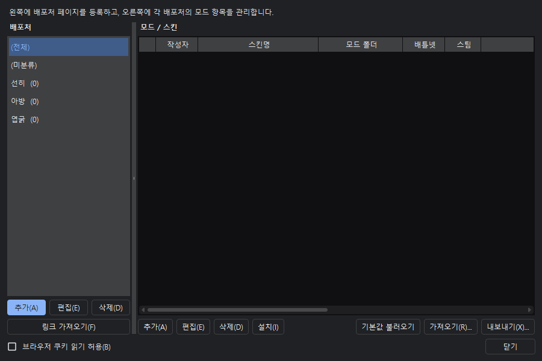

# 모드/스킨 관리자

**도구 > 모드/스킨 관리자**에서 엽니다. 스킨·모드를 내려받아 D2R 설치 폴더에 넣고, 계정마다 어떤 모드로 실행할지 고를 수 있게 해 줍니다.

## 화면 구성

| 영역 | 설명 |
|------|------|
| 왼쪽 **배포처** | 스킨이 올라오는 페이지 목록입니다. 괄호 안 숫자는 그 배포처에 등록된 항목 수입니다 |
| 오른쪽 **모드 / 스킨** | 배포처별 항목 목록입니다. 작성자·스킨명·모드 폴더·배틀넷/스팀 설치 여부·URL을 보여 줍니다 |

`(전체)`를 고르면 모든 항목이, `(미분류)`를 고르면 배포처에 묶이지 않은 항목이 나옵니다.

## 배포처

처음 켜면 배포처 세 곳이 기본으로 들어 있습니다.

| 배포처 | 형태 |
|--------|------|
| 선히 | 디아블로2 인벤 스킨 자료실 글 |
| 엽굵 | 유튜브 영상 설명의 다운로드 링크 |
| 아방 | Google Drive 공유 폴더 |

**링크 가져오기**를 누르면 그 페이지를 읽어 하위 다운로드 링크를 모아 항목으로 만들어 줍니다. 페이지를 읽는 동안에도 창은 멈추지 않습니다.

직접 **추가 / 편집 / 삭제**해서 다른 배포처를 등록할 수도 있습니다.

## 설치

항목을 고르고 **설치**를 누르면 내려받아 D2R 설치 폴더에 풉니다. 배틀넷판과 스팀판 경로는 각각 따로 기억합니다.

!!! note "UAC 창이 뜰 수 있습니다"
    게임이 `C:\Program Files` 안에 설치돼 있으면 그 폴더에 쓰기 위해 권한을 올려야 합니다. 먼저 일반 권한으로 시도해 보고 실패했을 때만 UAC 창이 뜹니다. 스팀 라이브러리가 다른 드라이브에 있으면 뜨지 않습니다.

설치한 모드는 계정 편집 창의 **실행 옵션 > 모드**에서 고를 수 있습니다.

## 브라우저 쿠키 읽기 허용

창 왼쪽 아래의 체크박스입니다. **기본값은 꺼짐**입니다.

구글 드라이브에 올라온 파일 중에는 **로그인한 상태라야 받을 수 있는 것**이 있습니다. 이 설정을 켜면 브라우저에 저장된 구글 로그인 정보(쿠키)를 읽어 그 다운로드에만 씁니다.

!!! warning "켜기 전에 알아 두세요"
    브라우저 쿠키에는 **구글 계정 세션**이 들어 있습니다. 그래서 켤 때 한 번 더 확인 창이 뜹니다.

    - 구글 드라이브 모드 다운로드 **그 용도로만** 씁니다.
    - 읽은 쿠키를 다른 곳으로 보내지 않습니다.
    - 백신이 이런 접근을 수상하게 보는 경우가 있습니다.

    꺼 두면 로그인이 필요한 파일만 받지 못할 뿐, 나머지 기능은 그대로 동작합니다.

끄는 것도 같은 자리에서 합니다. 체크를 해제하면 바로 꺼집니다(확인 창 없음).

!!! note "예전에는 환경설정 메뉴에 있었습니다"
    구글 드라이브 모드 다운로드에서만 쓰는 설정인데 환경설정 메뉴에 있어 무엇에 쓰는 동의인지 알기 어려웠습니다. 쓰는 자리로 옮겼습니다.

## 목록 주고받기

| 버튼 | 설명 |
|------|------|
| 기본값 불러오기 | 동봉된 기본 배포처 목록을 다시 넣습니다 |
| 가져오기 | 다른 사람이 내보낸 목록 파일을 읽습니다 |
| 내보내기 | 지금 목록을 파일로 저장합니다 |

!!! tip "설치 상태는 이 PC의 것입니다"
    어떤 모드를 설치했는지는 설정을 내보낼 때 함께 나가지 않습니다. 다른 PC로 옮겨도 의미가 없기 때문입니다.
