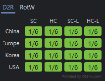
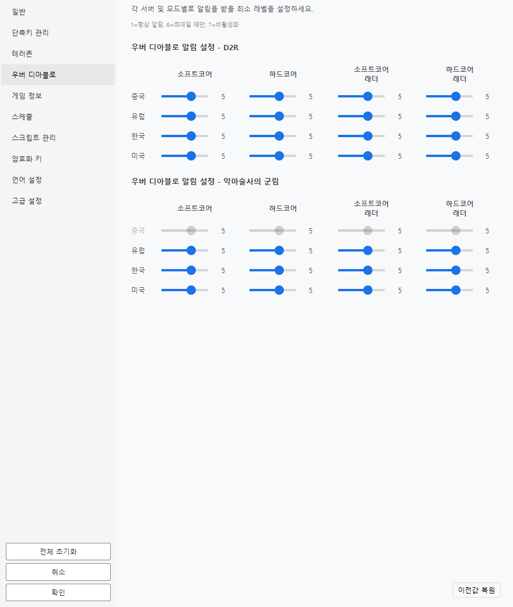

# 우버 트래커

   우버 디아블로(DClone) 상태를 지역/모드별로 추적합니다.

   

## 실행 방법

   메인메뉴에서 **도구 → 우버 추적기**로 실행합니다.

## 표시 정보

다음 조합별로 우버 디아블로 상태를 표시합니다:

- **게임버전**: 확장판, 악마술사의 군림(RotW)
- **지역**: Americas, Europe, Korea, China
- **모드**: 소프트코어(SC), 하드코어(HC)
- **타입**: 래더(Ladder), 비래더(Non-Ladder)

## 상태 단계

   |단계|한글 메시지|영문 메시지|
   |------|------|------|
   |1단계|성역에 공포의 응시가 느껴집니다.|Terror gazes upon Sanctuary.|
   |2단계|성역에 공포가 다가 옵니다.|Terror approaches Sanctuary|
   |3단계|성역 안에 공포가 형성되기 시작합니다.|Terror begins to from within Sanctuary.|
   |4단계|성역 곳곳에 공포가 퍼집니다.|Terror spreads across Sanctuary.|
   |5단계|성역에 공포가 풀려나려 합니다.|Terror is about to be unleashed upon Sanctuary.|
   |6단계|**디아블로가 성역을 침공했습니다.**|**Diablo has invade Sanctuary.**|

## 알림 설정

**환경설정 > 우버 디아블로**에서 지역·모드별로 **몇 단계부터 알릴지**를 따로 정합니다. 관심 없는 조합은 6단계로 올려 두면 침공했을 때만 알립니다.

확인 주기는 **환경설정 > 고급 설정 > Uber 추적 > 확인 간격**에서 바꿉니다(60~600초, 기본값 300초).

## 표시 방식

트래커는 세 가지 상태로 동작합니다.

| 상태 | 설명 |
|------|------|
| 꺼짐 | 보이지 않습니다 |
| 팝업 창 | 별도 창으로 띄웁니다 |
| 오버레이 | 게임 화면 위에 겹쳐 띄웁니다 |

- 창의 **X** 를 누르면 어느 쪽이든 꺼지고, **마지막에 쓰던 방식은 기억**합니다.
- 방식과 위치(8곳)는 패널에서 우클릭하거나 오버레이의 **≡** 버튼으로 고릅니다. 위치는 오버레이 방식일 때만 고를 수 있습니다.
- 오버레이는 클릭을 게임으로 통과시킵니다. 메뉴를 **≡** 버튼에서만 여는 것도 그 때문입니다 — 오버레이 전체에서 우클릭을 받으면 그 자리의 게임 우클릭이 막힙니다.

!!! note "창 모드에서만 보입니다"
    오버레이는 D2R이 창 모드나 테두리 없는 창 모드일 때만 보입니다. DirectX 전체화면에서는 표시되지 않습니다.

## 데이터 출처

   [d2emu.com](https://d2emu.com)에서 제공하는 API를 사용합니다.

!!! note "API 인증"
    2024년 8월 29일 이후 API 접근에 인증이 필요합니다.
    **v3.2 버전 이상**에서 지원합니다.