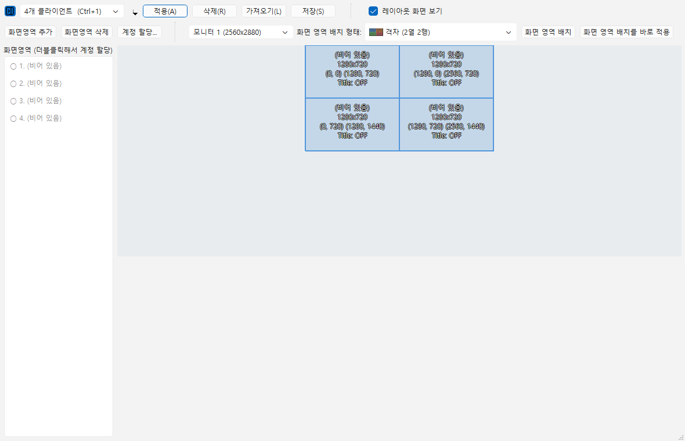

# 창 관리

## 창 제목 설정

D2R 클라이언트 창의 제목을 사용자가 지정한 설명으로 변경할 수 있습니다.

### 설정 방법

1. **환경설정 → 일반 → 제목설정** 활성화
2. 계정 등록 시 **설명** 항목 입력
3. 클라이언트 실행

### 표시 형식

- **설명 입력 시**: 입력한 설명 표시
- **설명 미입력 시**: `사용자명, 모드, 서버, 설정파일` 형식

### 개인정보 마스킹

이메일 정보를 마스킹 처리할 수 있습니다.

**환경설정 → 일반 → 개인정보 마스킹**

마스킹 비율은 **환경설정 → 일반 → 마스킹 비율** 슬라이더로 조정합니다.

- 0.2 = 20%만 표시
- 0.5 = 50%만 표시

## 창 정렬

여러 클라이언트 창을 자동으로 정렬합니다.

### 자동 정렬

**환경설정 → 일반 → 창 정렬**에서 정렬 방식을 선택합니다.

| 옵션 | 설명 |
|------|------|
| 없음 | 수동 배치 |
| 타일 자동 | 자동 타일 정렬 |
| 타일 2x2 | 2x2 그리드 정렬 |
| 타일 3x2 | 3x2 그리드 정렬 |
| 타일 3x3 | 3x3 그리드 정렬 |
| 캐스케이드 | 계단식 정렬 |
| 레이아웃 적용 | 저장된 레이아웃 적용 |

### 수동 정렬

**게임 옵션 → 창 정렬** 메뉴에서 선택한 계정들의 창을 정렬합니다.

## 레이아웃 관리

### 레이아웃 관리자 열기

**도구 → 레이아웃 관리자** (한국어 화면에서는 배치를 '화면배치', 그 안의 자리를 '화면영역'이라고 부릅니다)

### 기능

버튼이 어느 방향으로 움직이는지가 중요합니다.

| 버튼 | 방향 |
|------|------|
| 적용 | 화면배치 → 실제 창 |
| 가져오기 | 실제 창의 지금 위치 → 편집 화면 |
| 저장 | 편집 화면 → 화면배치 |
| 삭제 | 화면배치 비우기 |

오른쪽 줄은 **배치 형태**를 다룹니다.

| 버튼 | 하는 일 |
|------|---------|
| 화면 영역 배치 | 고른 형태로 **편집 화면에만** 그립니다. 실제 창은 그대로입니다 |
| 화면 영역 배치를 바로 적용 | 실제 창을 즉시 옮깁니다. 화면배치에 저장되지는 않습니다 |

### 개수 제한이 없습니다

예전에는 레이아웃이 8개 고정이었고 개수를 설정에서 바꿔야 했습니다. 지금은 **이름을 붙여 몇 개든** 만들 수 있습니다.

단축키 `Ctrl+1` ~ `Ctrl+8` 은 목록 **앞에서 여덟 개**를 순서대로 가리킵니다.

## 항상 위에

이 프로그램 창을 항상 최상단에 표시합니다.

**환경설정 → 일반 → 항상 위에** 체크

## 창 크기 조정

스크립트 실행 시 클릭 좌표를 일정하게 유지하기 위해 창 크기를 조정합니다.

### 설정

**환경설정 → 스크립트 관리 → 스크립트 실행 전 창 크기 조정** 활성화

- 활성화 시: 스크립트 실행 전 1280x720으로 창 크기 조정
- 비활성화 시: 창 크기 유지
