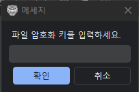
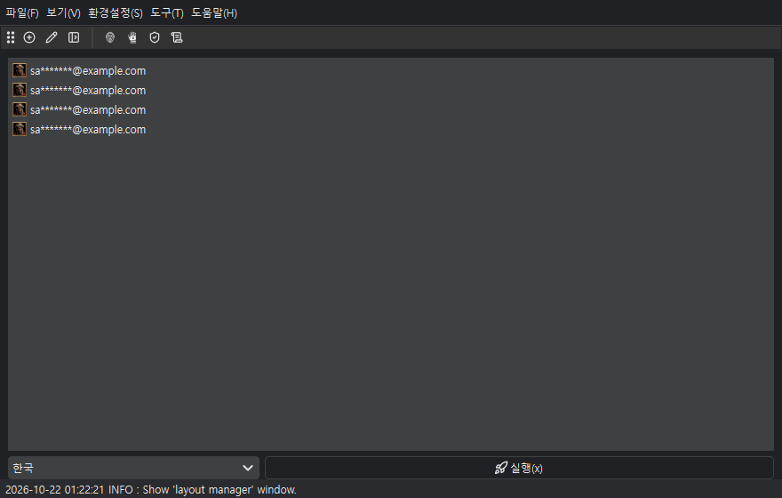
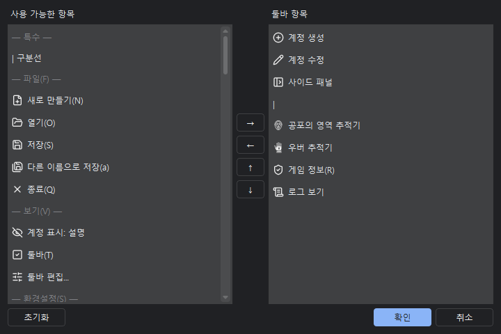
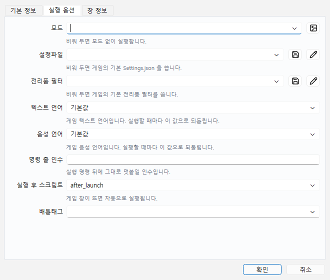
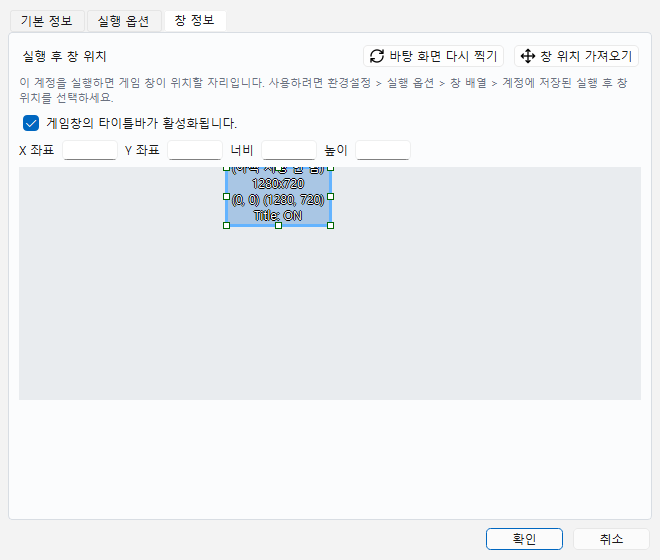

# 첫 실행

## 암호화 키 설정

처음 실행 시 파일 암호화 키를 물어봅니다. 계정정보 파일(default.dat)를 암호화하는데 사용되는 암호화 키입니다. 보안을 위한 최소한의 장치이니 다른 사람들이 유추하기 어렵게 만드세요. 8자리 이상, 특수문자, 숫자 포함해서 만드는 것을 추천합니다.

- 나중에 변경하실 때는 **환경설정 → 환경설정 변경 → 암호화 키**에서 변경할 수 있습니다.

## 메인 화면 구성

|영역|설명|
|----|-----|
|메뉴바|**파일 · 보기 · 환경설정 · 도구 · 도움말** 다섯 개 메뉴가 있습니다.|
|툴바|자주 쓰는 기능을 아이콘으로 모아 둔 줄입니다. 계정 추가·수정, 사이드 패널, 테러존·우버 트래커, 게임 정보, 로그 보기가 기본으로 들어 있습니다.|
|사이드 패널|계정 정보를 입력·수정·삭제하는 영역입니다. **보기 > 사이드 패널**로 접거나 펼칩니다.|
|계정 목록|등록된 계정을 표시합니다. 보기 모드(목록 / 자세히 / 작은 아이콘 / 보통 아이콘 / 큰 아이콘)를 **보기** 메뉴에서 고를 수 있습니다.|
|하단 패널|서버를 고르고 실행하는 영역입니다. 하단을 더블클릭해도 접거나 펼칠 수 있습니다.|
|상태표시줄|진행 상황과 오류가 한 줄로 지나갑니다. 지나간 내용은 **도구 > 로그 보기**에서 다시 볼 수 있습니다.|

### 툴바 바꾸기

**보기 > 툴바 사용자 지정**에서 어떤 버튼을 어떤 순서로 둘지 정합니다.

왼쪽의 메뉴 항목을 오른쪽으로 옮기면 툴바에 나옵니다. 구분선도 넣을 수 있고, 위/아래로 순서를 바꿉니다.

!!! note "한 번 고치면 그 구성이 유지됩니다"
    새 버전에서 기본 구성이 바뀌어도 **직접 고친 툴바는 그대로** 둡니다. 새로 추가된 버튼을 쓰고 싶으면 이 창에서 직접 넣으세요.

!!! tip "창 크기는 기억됩니다"
    창을 키우거나 줄여 두면 다음에 열 때 그 크기로 뜹니다. 위치도 함께 기억합니다.

## 계정 등록

계정 창은 탭 세 장으로 나뉩니다.

|탭|무엇을 넣는가|
|----|-----|
|**기본 정보**|로그인에 필요한 것 — 설명, 사용자, 비밀번호, 인증 방식, 런처(또는 토큰·스팀 계정)|
|**실행 옵션**|모드, 설정파일, 전리품 필터, 키/조작 파일, 실행 후 스크립트|
|**창 정보**|이 계정의 창을 띄울 위치와 크기. 화면을 끌어서 정할 수 있습니다|

입력값에 문제가 있으면 **그 입력칸 바로 아래에 빨간 줄**로 알려 주고, 다른 탭에 있는 오류는 탭 제목에 ● 표시가 붙습니다.

#### 실행 옵션 탭

모드·설정파일·전리품 필터처럼 **실행에 꼭 필요하지는 않은** 것들입니다. 나중에 채워도 됩니다.

#### 창 정보 탭

이 계정의 창을 띄울 자리를 **그림에서 끌어서** 정합니다. 숫자로도 고칠 수 있고 둘은 서로 따라 움직입니다. 비워 두면 "이 계정은 창을 배치하지 않음"이라는 뜻이라, 값을 미리 채워 두지는 않습니다.

배경 화면은 창 정보 탭을 **처음 열 때 한 번만** 찍습니다(화면 전체 캡처라 매번 하면 느립니다). 화면 구성이 바뀌었으면 **바탕 화면 다시 찍기**를 누르세요.

!!! note "쓰려면 창 배열 방식을 맞춰야 합니다"
    여기서 정한 위치는 **환경설정 > 일반 > 창 배열 방식**이 `계정에 저장된 실행 후 창 위치`일 때 쓰입니다.

|순서|설명|
|:---:|---|
|1|로그인에 필요한 배틀넷 계정 정보(**사용자**와 **비밀번호**)를 입력하고 **인증방식**을 선택합니다.|
|2|**인증 방식**에 따라서 **런처**를 지정해줍니다. 웹 토큰 방식의 경우에는 자동 또는 수동으로 토큰을 발급합니다.|
|3|**확인** 버튼을 클릭하면 오른쪽 계정 목록에 추가됩니다.  위의 작업을 필요한 계정 수만큼 반복합니다.|
|4|**파일** > **저장**으로 파일로 저장해야 프로그램 다시 시작 시 위 작업을 반복하지 않습니다.|

~~아시아 서버의 경우에는 사용자와 비밀번호 외에 추가로 토큰을 발급, 저장 후 사용해야 배틀넷 서버에 접속이 가능합니다. FAQ에 "토큰은 어떻게 만드나요"를 참고하세요.~~

- 모드(mod)와 설정파일, 전리품 필터, 설명 등은 실행을 위해서 필수적인 항목은 아닙니다. 나중에 설정해도 됩니다.
- 사용자 아이디, 비밀번호에 콤마(,) 세미콜론(\;), 등호(=) 공백문자(스페이스, 탭 등) 등이 포함된 경우 명령줄 실행이 되지 않는 경우가 있습니다. 이는 이들 문자가 명령줄(command line)에서 구분자 등으로 사용되기 때문입니다.

### 필수 항목

|항목|설명|
|:---:|---|
|**설명**|계정 목록과 창 제목에 표시할 짧은 메모입니다.|
|**사용자**|배틀넷 로그인에 쓰는 **이메일 주소 또는 휴대전화번호**입니다. 배틀넷 로그인 화면이 둘 다 받으므로 전화번호로 가입한 계정도 등록할 수 있습니다. 전화번호는 **적은 그대로** 저장됩니다. 표기를 바꾸면(`010-1234-5678` ↔ `01012345678`) 다른 계정으로 취급되니 한 가지로 통일하세요.|
|**비밀번호**|배틀넷 계정 비밀번호입니다. **비워 두지 마세요.** 비밀번호 없이 로그인을 시도하면 계정이 잠길 수 있습니다.|
|**인증방식**|웹 토큰 / 명령줄 / 배틀넷 런처 / 스팀 OTP(인증기)를 쓰는 계정은 웹 토큰을, 그 외에는 명령줄을 권합니다. 스팀으로 구매했다면 스팀을 고릅니다.|
|**런처**|`d2r.exe` 또는 `Diablo II Resurrected Launcher.exe` 경로입니다. 웹 토큰·명령줄은 `d2r.exe`, 배틀넷 런처 방식은 런처 실행 파일을 고릅니다. 스팀 방식은 이 칸 대신 **스팀 계정** 칸이 나옵니다.|

!!! note "필수 표시(*)는 인증 방식에 따라 달라집니다"
    토큰은 웹 토큰 방식일 때만, 런처는 스팀이 아닐 때만 필수입니다. 방식을 바꾸면 표시와 안내 문구가 함께 바뀝니다.

### 선택 항목

|항목|설명|
|:---:|---|
|**모드**|사용할 모드명 (없으면 비워둠), 해당 계정에서 사용할 모드명을 선택합니다. 사전에 게임 폴더에 모드를 설치해 둬야 합니다. |
|**설정파일**|클라이언트별 해당 계정에서 사용할 설정파일(Settings.json)입니다. **Settings_메인.json** 처럼 **Settings**로 시작하는 json파일로 미리 생성해 놓으세요.|
|**전리품 필터**|클라이언트별 해당 계정에서 사용할 전리품 필터 파일(lootfilter.json)입니다 **lootfilter_메인.json** 처럼 **lootfilter**로 시작하는 json파일로 미리 생성해 놓으세요.|
|**설명**|창 제목, 계정 목록 등에 표시할 설명입니다.|

!!! warning "파일 저장"
    계정 정보를 저장하지 않으면 프로그램 종료 시 사라집니다.
    **파일 → 저장** 또는 `Ctrl+S`로 저장합니다.
    기본 저장 위치: 실행 파일과 같은 폴더의 `default.dat`
    다른 위치에 저장: **파일 → 다른 이름으로 저장**

!!! info "인증방식 선택"
    **1. 웹 토큰 방식 (권장)**
    - 토큰을 미리 발급해 두고 그 토큰으로 인증합니다
    - OTP(인증기)를 쓰는 계정도 됩니다
    - **배틀넷 런처가 쓰는 것과 사실상 같은 흐름**이라 가장 안정적입니다
    토큰 발급 방법은 [계정 관리 - 토큰 발급](../features/account-management.md#토큰-발급)을 참고하세요.

    **2. 명령줄 방식**
    - 가장 간단합니다. 아이디·비밀번호를 게임에 직접 넘깁니다
    - 다만 **디아블로2 시절부터 있던 옛 경로**라, 블리자드가 마음먹으면 통째로 끌 수 있습니다. 실제로 2023년에 **아시아 서버에 대해 모든 사용자의 명령줄 접속이 막힌 적**이 있습니다(이후 복구). 접속이 안 되는 사례도 이 방식에서 더 자주 나옵니다
    - 인증기(OTP)를 쓰는 계정은 쓸 수 없습니다
    - 비밀번호가 **작업 관리자의 명령줄에 그대로 보입니다**
    
    **3. 배틀넷 런처 방식**
    - 배틀넷 런처를 띄워 아이디·비밀번호를 대신 입력하고 실행합니다
    - 런처 화면의 입력칸을 **화면 좌표가 아니라 요소 이름으로** 찾으므로 런처가 업데이트돼도 잘 따라갑니다
    - 이미 로그인돼 있으면 로그인 과정을 건너뜁니다. OTP를 기다리는 동안에도 다음 단계로 넘어가지 않습니다

    **4. 스팀 방식**
    - 스팀으로 구매한 계정용입니다. `steam.exe`에 실행 인자만 넘깁니다
    - 계정을 바꿀 때는 스팀을 껐다 켜고, 사용자가 직접 로그인할 때까지 기다립니다

## 다음 단계

계정 등록이 완료되었으면 [멀티 런처](../features/multi-launcher.md)를 확인하여 실행 방법을 알아보세요.
