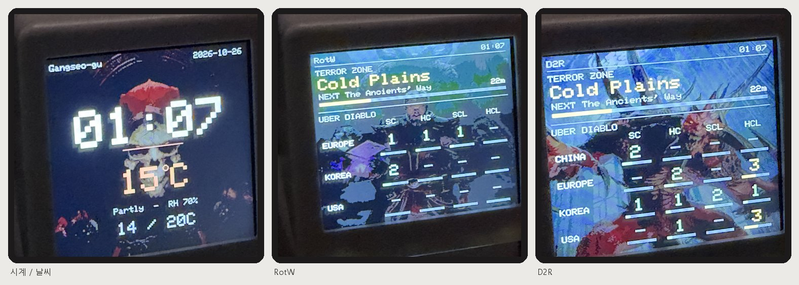
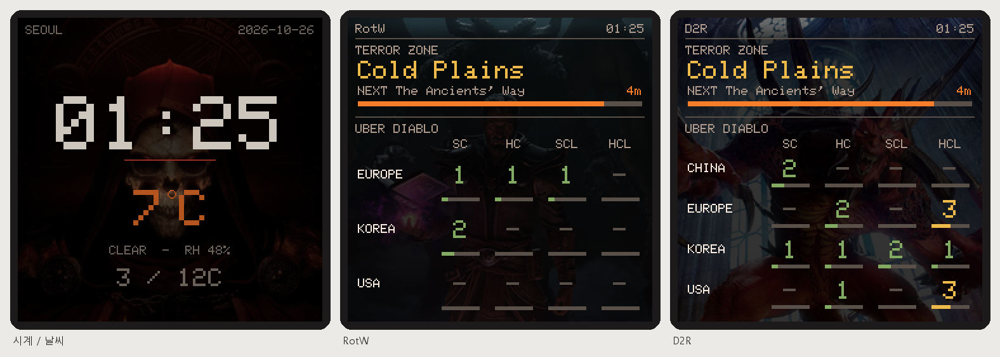
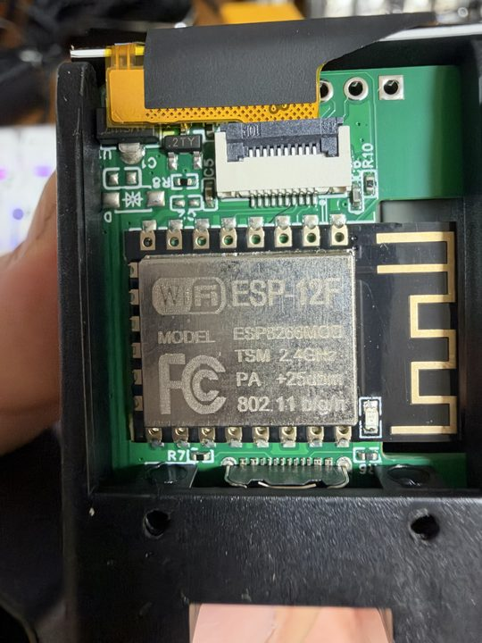
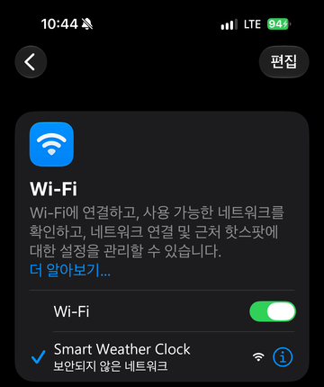
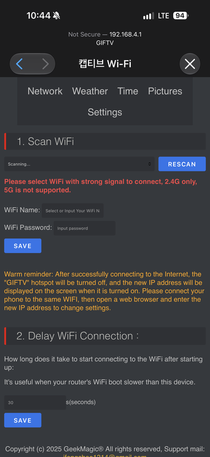
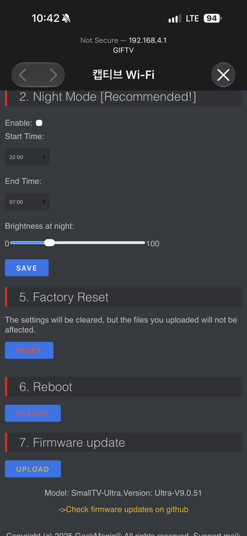
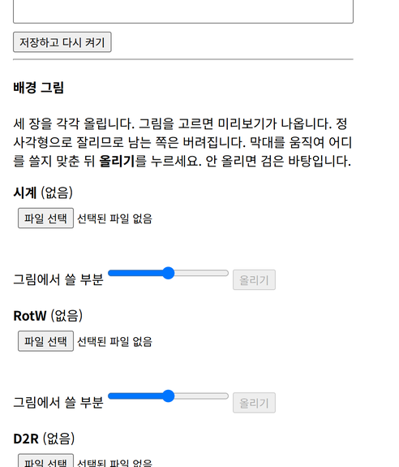

# 날씨시계에 테러존/우버 알리미 올리기



*실제 기기에서 찍은 모습입니다. 배경 그림은 각자 올린 것이라 다르게 보입니다.*

시중에 파는 **GeekMagic SmallTV**(7~8천 원대)의 펌웨어를 바꿔서, **테러존과 우버 디아블로 상태를 시계와 함께** 보여 주는 탁상 알리미로 만듭니다.

같은 겉모양이라도 **원래 펌웨어가 두 가지**(Smart Weather Clock / SmallTV-Ultra)입니다. 안의 기판과 화면은 같아서 **올릴 파일은 똑같고**, 처음 설정하는 화면과 펌웨어 올리는 메뉴만 다릅니다.

PC를 켜지 않아도 되고 게임과도 아무 관계가 없습니다. 기기가 혼자 Wi-Fi로 값을 받아 옵니다.

8초마다 세 장이 돌아갑니다.

| 장 | 보이는 것 |
|---|---|
| **시계 / 날씨** | 큰 시:분 · 날짜 · 기온 · 습도 · 오늘 최저/최고 |
| **RotW** | 테러존 현재/다음 지역 · 남은 시간 · 우버 단계 표 (유럽·한국·미국 × SC/HC/SCL/HCL) |
| **D2R** | 같은 내용의 D2R 쪽 (중국·유럽·한국·미국) |



*글자 자리를 또렷하게 보여 주려고 펌웨어의 그리기를 그대로 흉내 내 그린 것입니다.*

!!! info "멀티 런처와 따로 도는 하드웨어입니다"
    프로그램을 켜 두지 않아도, 게임을 켜지 않아도 기기가 혼자 값을 받아 옵니다.

---

## 준비물

- **GeekMagic SmallTV** — ESP8266(**ESP-12F**) 판, 1.54" 240×240 화면.
  아래 두 가지 모두 됩니다(기판·화면이 같습니다).
    - **Smart Weather Clock**(SD Pro) — 설정 페이지 제목이 `Smart Weather Clock`이고 아래쪽에 **Firmware Update (OTA)** 가 있는 것
    - **SmallTV-Ultra** — 설정 화면 위쪽에 `Network · Weather · Time · Pictures · Settings` 메뉴가 있는 것

    기판이 **ESP32**인 판(Pro 등)에는 맞지 않습니다.
- USB-C 전원(휴대폰 충전기).
- **2.4GHz Wi-Fi** — ESP8266은 5GHz를 쓰지 못합니다.
- 휴대폰 — 처음 Wi-Fi를 설정할 때만 씁니다.
- **배경으로 쓸 그림 3장** — 아무 그림이나 됩니다. 안 올리면 검은 바탕으로 돕니다.

---

## 파일

| 프로그램 | 파일 | 배포일 |
|---|---|---|
| **테러존/우버 알리미 펌웨어** | [SDP-d2r-clock.bin](https://github.com/saintsc-ai/d2r-manual/releases/download/latest/SDP-d2r-clock.bin) | 2026-10-26 |

!!! note "파일 이름을 바꾸지 마세요"
    원래 펌웨어는 이름이 **`SDP`로 시작하는 파일만** 받습니다.

!!! info "배경 그림은 들어 있지 않습니다"
    펌웨어에는 그림이 한 장도 없습니다. 설치한 뒤 **각자 원하는 그림을 올립니다**(6번).
    그래서 펌웨어가 가볍고, 배경을 바꿀 때 펌웨어를 다시 올리지 않아도 됩니다.

---

## 설치 순서

새 기기는 아래 6단계입니다. **4·5번은 처음 한 번뿐**이고, 나중에 펌웨어를 바꿀 때는 설정과 배경이 그대로 남습니다.

### 내 기기가 어느 쪽인가

전원을 넣고 **처음 뜨는 화면과 Wi-Fi 이름**으로 구분합니다. 1~3번만 다르고 **4번부터는 똑같습니다.**

| | **A. Smart Weather Clock** (SD Pro) | **B. SmallTV-Ultra** |
|---|---|---|
| 기기가 띄우는 Wi-Fi 이름 | `Smart Weather Clock` | `GIFTV` |
| 처음 화면 | 연결 안내 → `SD Pro V1.0.x` | `WiFi: GIFTV`, `http://192.168.4.1` |
| 설정 화면 | WiFi Settings · City Settings · Photo · GIF | 위쪽 메뉴 Network · Weather · Time · Pictures · Settings |
| 펌웨어 올리는 곳 | **Firmware Update (OTA)** | **Settings → 7. Firmware update** |
| 제조사 펌웨어 | [JUZIPi-tech/SD_PRO](https://github.com/JUZIPi-tech/SD_PRO) (`SDPro_V1.0.x_….bin`) | [GeekMagicClock/smalltv-ultra](https://github.com/GeekMagicClock/smalltv-ultra) (권장 [Ultra-V9.0.50](https://github.com/GeekMagicClock/smalltv-ultra/tree/main/Ultra-V9.0.50), `FW-Smalltv-Ultra-V9.0.50.zip`) |
| 제조사 설명서 | 상자 안 *Smart Clock Manual* | [안내 페이지](https://qr61.cn/onQs0U/qlPEzlA)(상자 QR) · [한국어 PDF](https://ncstatic.clewm.net/rsrc/2025/0430/12/57ce98fdda436e684ed70e7d067fee37.pdf) · [여러 언어](https://github.com/GeekMagicClock/smalltv-ultra/tree/main/User%20Manuals%20%5BMany%20Languages%5D) |


{ width="320" }

*기판은 두 종류가 같습니다. 그래서 **올릴 파일도 똑같고**, 처음 설정하는 화면과
펌웨어 올리는 메뉴만 다릅니다.*

!!! tip "SmallTV-Ultra 를 받으셨다면"
    제조사 안내(상자 QR): [GeekMagic SmallTV-Ultra](https://qr61.cn/onQs0U/qlPEzlA) ·
    [한국어 설명서 PDF](https://ncstatic.clewm.net/rsrc/2025/0430/12/57ce98fdda436e684ed70e7d067fee37.pdf) ·
    [원래 펌웨어(권장 V9.0.50)](https://github.com/GeekMagicClock/smalltv-ultra/tree/main/Ultra-V9.0.50).
    되돌리고 싶을 때 쓰면 됩니다.

### 1. 기기 Wi-Fi에 연결

전원을 넣고, 휴대폰을 SmallTV가 띄운 Wi-Fi에 연결합니다. '인터넷 없음' 경고가 나와도 그대로 붙어 있습니다.

**A. Smart Weather Clock**

휴대폰 Wi-Fi 목록에서 **`Smart Weather Clock`** 에 붙습니다.

{ width="240" }

**B. SmallTV-Ultra**

화면에 `WiFi: GIFTV`, `http://192.168.4.1` 이 나옵니다. 휴대폰을 **`GIFTV`**(비밀번호 없음)에 붙입니다.

{ width="320" }
{ width="240" }

설정 화면이 저절로 뜨지 않으면 브라우저로 **`http://192.168.4.1`** 을 엽니다. 그래도 안 열리면 모바일 데이터를 잠깐 끕니다.

### 2. Wi-Fi 정보 입력

집이나 사무실 Wi-Fi를 설정합니다. 붙으면 화면에 IP 주소(예: `192.168.0.23`)가 나옵니다. **적어 둡니다.**

**A. Smart Weather Clock**

**WIFI SETTINGS** 목록에서 집 Wi-Fi를 고르고(안 보이면 Refresh List) 비밀번호를 넣고 **Connect**.

**B. SmallTV-Ultra**

위쪽 **Network** → Wi-Fi 이름·비밀번호 → **SAVE**.

{ width="240" }

### 3. 커펌 설치

PC 브라우저로 `http://<적어 둔 주소>` 를 엽니다.

**A. Smart Weather Clock**

1. 아래쪽 **Firmware Update (OTA)** 에서 `SDP-d2r-clock.bin` 을 고릅니다.
2. **Start Update** → 확인.
3. "Update Success! Rebooting..." 이 나오면 끝입니다.

명령으로 해도 됩니다(Windows 10 이상·맥·리눅스에 기본으로 있는 `curl`).

```sh
curl -F "update=@SDP-d2r-clock.bin" http://<기기 주소>/update_ota
```

**B. SmallTV-Ultra**

1. **Settings** 맨 아래 **7. Firmware update → UPLOAD** 에서 `SDP-d2r-clock.bin` 을 고르고 **Update**.
2. "Update Success! Rebooting..." 이 나오면 끝입니다.

같은 화면 아래쪽 `Model: SmallTV-Ultra` 로 Ultra 인 것을 한 번 더 확인할 수 있습니다.

{ width="240" }

명령으로 할 때는 **보내는 이름과 주소가 다릅니다**(`firmware=` · `/update`).

```sh
curl -F "firmware=@SDP-d2r-clock.bin" http://<기기 주소>/update
```

!!! warning "처음 켤 때 1분쯤 걸립니다"
    배경을 담을 자리를 만드느라 처음 한 번만 오래 걸립니다. 화면이 까맣더라도 기다려 주세요.

### 4. 커펌된 기기 Wi-Fi에 연결

원래 펌웨어가 쓰던 설정은 그대로 쓸 수 없어 지워집니다. 그래서 한 번 더 붙여 줍니다.

1. 다시 켜지면 화면에 `join d2rclock-xxxxxx` / `open 192.168.4.1` 이 나옵니다.
2. 휴대폰 Wi-Fi 목록에서 **`d2rclock-xxxxxx`** 에 연결합니다(비밀번호 없음).

!!! tip "이 화면이 안 나오고 바로 시계가 뜬다면"
    기기가 원래 펌웨어의 기억해 둔 Wi-Fi로 저절로 붙은 것입니다. **4·5번을 건너뛰고 6번으로** 가세요.

### 5. Wi-Fi 정보 입력

1. 브라우저에서 **`http://192.168.4.1`** 을 엽니다.
    - "인터넷 없음" 경고가 뜨면 **연결 유지**를 고릅니다.
    - 페이지가 안 열리면 모바일 데이터를 잠깐 끕니다.
2. Wi-Fi 이름과 비밀번호를 넣고 **저장하고 다시 켜기**를 누릅니다.

!!! tip "OTA 비밀번호는 비워 두세요"
    꼭 정해야 하는 것이 아닙니다. 비워 두면 설정을 바꿀 때마다 묻지 않아 편합니다.
    정해 두면 **Wi-Fi·날씨 위치를 바꿀 때와 펌웨어를 올릴 때 그 비밀번호를 묻습니다** —
    잊어버리면 번거로워집니다. 집 안에서만 쓰는 기기라 비워 두어도 됩니다.
    (배경 밝기는 어느 쪽이든 비밀번호 없이 바꿀 수 있습니다.)

다시 켜지면 시계가 돌기 시작하고, **화면 아래에 기기 주소가 뜹니다.** 배경을 올리면 저절로 사라집니다.

### 6. 배경 그림 3장 올리기

PC 브라우저로 `http://<기기 주소>`를 열고 아래쪽 **배경 그림**으로 갑니다.



**화면이 정사각형이라 그림의 일부는 잘려 나갑니다.** 세로로 긴 사진이면 위아래 중 한쪽이, 가로로 긴 사진이면 좌우 중 한쪽이 버려집니다. 어느 쪽을 남길지 고르는 것이 **막대**입니다.

1. **파일 선택**으로 그림을 고릅니다. 바로 아래에 **잘린 결과가 작게 나타납니다.**
2. **막대를 좌우로 움직이면** 그림에서 쓸 부분이 바뀝니다. 미리보기가 따라 움직이니 마음에 들 때까지 맞춥니다.
3. **올리기**를 누릅니다. "올렸습니다"가 뜨면 끝입니다.
4. 세 칸(시계 · RotW · D2R)을 각각 합니다.

!!! example "예를 들면"
    디아블로 2 키아트는 세로로 길고 **위에 해골, 아래에 로고**가 있습니다.
    막대를 왼쪽 끝으로 하면 해골만, 오른쪽 끝으로 하면 로고만 들어옵니다.

!!! info "그림 크기·형식은 아무래도 됩니다"
    브라우저가 알아서 240×240으로 맞춰 보냅니다. 미리보기는 **기기에서 보일 만큼 어둡게** 해서 보여 주므로, 화면에서 본 것과 기기가 크게 다르지 않습니다.

끝입니다.

---

---

## 주소를 잊었을 때

설치한 뒤 기기 주소(`192.168.0.23` 같은)를 잊어버려도 찾을 길이 셋 있습니다.

**1. 전원을 뽑았다 꽂습니다.** Wi-Fi에 붙을 때마다 **15초 동안** 주소를 크게 보여 줍니다.
Wi-Fi 이름, 큰 글씨 주소, `http://<주소>`, `d2rclock-xxxxxx.local` 이 한 화면에 나옵니다.

**2. 이름으로 엽니다.** 주소 대신 **`http://d2rclock-xxxxxx.local`** 로도 들어갑니다
(`xxxxxx` 는 기기마다 다르고, 위 화면과 설정 페이지에 적혀 있습니다).

!!! warning "회사·공유 사무실 Wi-Fi 에서는 안 될 수 있습니다"
    맥·아이폰·안드로이드 대부분·Windows 10 이상에서 됩니다. 다만 **기업용 무선 장비**는
    유선과 Wi-Fi 사이로 이 신호를 넘기지 않는 경우가 있어, 그런 곳에서는 이름으로 못 찾습니다.
    그때는 1번이나 3번을 쓰세요.

**3. 공유기 설정에서 찾습니다.** 연결된 기기 목록에 **`d2rclock-xxxxxx`** 로 나옵니다
(아직 원래 펌웨어면 `ESP-xxxxxx` 입니다).

## 배경이 너무 밝을 때

화면 보드는 PC 화면보다 밝게 냅니다. 설정 페이지에서 **배경을 다시 올리지 않고** 바꿀 수 있습니다.

1. `http://<기기 주소>` 를 엽니다.
2. **배경 밝기 0~100** 칸의 숫자를 낮춥니다(기본 45).
3. 저장하면 다시 켜지면서 적용됩니다.

글자 색은 그대로이므로 **값을 내릴수록 글자가 또렷해집니다.** 45가 아직 밝으면 30이나 25로 내려 보세요.

!!! warning "화면 밝기 설정이 아닙니다"
    이 기기의 백라이트는 켜고 끄기뿐이고 밝기 조절이 없습니다. 위 값은 **배경 그림을 그릴 때 깎는 양**입니다.

---

## 나중에 새 펌웨어로 바꾸기

**Wi-Fi 설정·배경 그림·밝기는 그대로 남습니다.** 펌웨어만 바뀝니다.

`http://<기기 주소>` 를 열고 아래쪽 **펌웨어 업데이트** 를 누릅니다. 새 `SDP-d2r-clock.bin` 을 고르고 올리면 "Update Success! Rebooting..." 이 나옵니다. 처음 설치할 때와 같은 방식입니다.

OTA 비밀번호를 정해 두었다면 아이디 `admin`, 비밀번호는 그 값을 묻습니다.

명령으로 하려면:

```sh
curl -F "update=@SDP-d2r-clock.bin" http://<기기 주소>/update
```

??? note "espota 로도 됩니다 (OTA 비밀번호를 정해 둔 경우)"
    ```sh
    python espota.py -i <기기 주소> -p 8266 -a "<OTA 비밀번호>" -f SDP-d2r-clock.bin
    ```

    [espota.py](https://raw.githubusercontent.com/esp8266/Arduino/master/tools/espota.py)는 파이썬 3만 있으면 됩니다.
    **비밀번호를 비워 두면 이 방법은 쓸 수 없습니다** — 위의 웹 업데이트를 쓰세요.

---

---

## 원래 펌웨어로 되돌리기

이 펌웨어가 돌고 있으면 **그대로 Wi-Fi로** 되돌릴 수 있습니다. 위 '나중에 새 펌웨어로
바꾸기'와 같은 방법으로, 올릴 파일만 제조사 것으로 바꾸면 됩니다.

**A. Smart Weather Clock (SD Pro)** — [JUZIPi-tech/SD_PRO](https://github.com/JUZIPi-tech/SD_PRO) 의 `SDPro_V1.0.x_….bin`.

**B. SmallTV-Ultra** — [GeekMagicClock/smalltv-ultra](https://github.com/GeekMagicClock/smalltv-ultra) 에서 제조사 권장 판 폴더(지금 [Ultra-V9.0.50](https://github.com/GeekMagicClock/smalltv-ultra/tree/main/Ultra-V9.0.50))의 `FW-Smalltv-Ultra-V9.0.50.zip`
을 받아 **풀고, 안의 `.bin`** 을 올립니다. 판마다 바뀐 점은 같은 폴더의 `update_history.txt`
에 있습니다. 되돌린 뒤 날씨·테마 설정은 제조사 설명서를 보면 됩니다.

!!! note "Ultra 되돌리기는 아직 실제로 해 보지 않았습니다"
    Ultra 의 원래 펌웨어는 설정 웹 화면과 그림 파일을 따로 두는 것으로 보이는데,
    이 펌웨어는 그 부분을 건드리지 않으므로 `.bin` 만 올리면 될 것으로 봅니다.
    다만 한 대로 실제로 확인한 것은 아닙니다.

!!! warning "배경·설정은 돌아오지 않습니다"
    되돌리면 올려 둔 배경 3장과 밝기·Wi-Fi 설정이 사라집니다. 다시 알리미를 올리면
    처음 설치하는 것과 같이 4~6번을 다시 해야 합니다.

## 문제가 생기면

| 증상 | 할 일 |
|---|---|
| 펌웨어를 바꾼 뒤 화면이 한참 까맣습니다 | 처음 한 번은 1분쯤 걸립니다. 그래도 안 되면 휴대폰 Wi-Fi 목록에 `d2rclock-xxxxxx` 가 보이는지 봅니다. |
| `192.168.4.1` 이 안 열립니다 | 주소창에 `http://` 까지 직접 입력하고, 모바일 데이터를 끕니다. |
| 날씨가 엉뚱한 동네로 나옵니다 | 위치를 비워 두면 **IP 로 짐작**하는데 통신사 기준이라 사는 곳과 다를 수 있습니다. 설정 페이지의 **날씨 위치** 에 `37.55,126.97,우리동네` 처럼 넣으면 정확해집니다. |
| 테러존이 `-` 로만 나옵니다 | 값을 못 받은 것입니다. Wi-Fi 연결을 보고 5분 기다려 봅니다. |
| 세 장이 안 돌고 한 장만 보입니다 | 시계가 안 맞으면(인터넷 시각 실패) 화면이 돌지 않습니다. Wi-Fi를 확인합니다. |
| 배경을 올렸는데 아래쪽이 검게 끊깁니다 | 올리다 끊긴 것입니다. 같은 칸에 다시 올립니다. |
| 화면 아래 주소가 계속 보입니다 | 시계 배경(첫 칸)을 아직 안 올린 것입니다. 올리면 사라집니다. |
| 올려 둔 배경이 사라졌습니다 | 설정 페이지 위쪽 `storage` 가 `0/1000KB` 에 가까우면 저장 공간이 초기화된 것입니다. 다시 올리면 됩니다. |
| 배경을 올리려는데 계속 실패합니다 | **배경 모두 지우기**를 한 번 누르면 저장 공간을 고칩니다. 그 뒤 다시 올려 보세요. |
