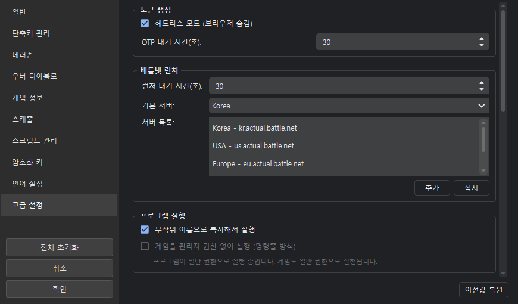

# 상세 설정

환경설정 대화상자에서 게임 정보, 단축키, 스크립트, 스케줄, 고급 옵션을 설정할 수 있습니다.

## 게임 정보

게임 생성 시 사용되는 정보를 설정합니다.

| 항목 | 설명 | 범위 | 예시 |
|------|------|------|------|
| 게임 접두어 | 게임 이름 앞부분. 🎲 버튼으로 무작위 생성 | 합쳐서 15자 | MAG |
| 게임 번호 | 현재 게임 번호 | 0 ~ 99999 | 1 |
| 자릿수 | 번호를 몇 자리로 채울지 | 1 ~ 5 | 2 |
| 비밀번호 | 게임 비밀번호 | | 0402 |

### 게임 이름 생성 규칙

`게임 제목 + 게임 번호` 형식으로 생성됩니다.

- 게임 제목: `MAG`, 번호: `1`, 자릿수: `2` → `MAG01`
- 게임 제목: `MAG`, 번호: `1`, 자릿수: `3` → `MAG001`

설정 화면에서 미리보기로 생성될 게임 이름을 확인할 수 있습니다.

!!! warning "접두어와 번호를 **합쳐서** 15자"
    15자는 접두어만의 한도가 아니라 **완성된 게임 이름**의 한도입니다. 자릿수를 5로 두면 접두어는 10자까지만 들어갑니다.

    넘치면 **접두어 쪽이 잘리고** 미리보기가 빨간색으로 바뀝니다. 번호는 방을 구분하는 값이라 잘리지 않습니다.

    **한글도 15자**입니다. 게임이 유니코드로 받으므로 영문과 같습니다.

!!! note "미리보기와 실제가 같습니다"
    미리보기에 보이는 이름이 실제로 만들어지는 이름입니다. **도구 > 게임 정보** 창에서도 같은 값을 고칠 수 있고 한도도 같습니다.

## 단축키 관리

### 기본 단축키

| 단축키 | 동작 |
|--------|------|
| Ctrl+A | 자동 (나가기→생성/참가) |
| Ctrl+N | 게임 생성 |
| Ctrl+J | 게임 참가 |
| Ctrl+X | 게임 나가기 |
| Ctrl+L | 레거시 모드 |
| Ctrl+T | 창 제목 토글 |
| Ctrl+Plus | 게임 번호 증가 |
| Ctrl+Minus | 게임 번호 감소 |
| Ctrl+M | 보석 합치기 |
| Ctrl+Alt+1~0 | 1~10번 클라이언트 활성화 |
| Ctrl+1~8 | 화면배치(레이아웃) 1~8 적용 |

!!! note "`Ctrl+1` ~ `Ctrl+8` 은 **목록 순서**를 가리킵니다"
    화면배치는 개수 제한이 없고, 이 키들은 목록 **앞에서 여덟 개**를 순서대로 가리킵니다. 순서를 바꾸면 같은 키가 다른 배치를 가리킵니다.

### 사용자 정의 단축키

환경설정 왼쪽 목록의 **단축키 관리**에서 사용자 정의 단축키를 추가할 수 있습니다.

1. **단축키** 입력란을 클릭하고 원하는 키 조합 입력
2. **스크립트** 콤보박스에서 실행할 스크립트 선택
3. **설명** 입력 (선택사항)
4. **추가** 버튼 클릭

스크립트명 대신 외부 스크립트 파일 경로를 지정할 수도 있습니다.

- 상대경로 또는 절대경로 가능
- 확장자는 `.script`만 허용

!!! tip "Caps Lock이 켜져 있어도 동작합니다"
    키 이름이 바뀌어 오는 경우(`a` → `A`, `1` → `!`)에도 **스캔코드로 한 번 더 확인**하므로 같은 키로 봅니다.

### 사용 가능한 키

- 수식키: `Alt`, `Ctrl`, `Shift`, `Windows`
- 방향키: `Left Alt`, `Right Alt`, `Left Ctrl` 등
- 일반키: 알파벳, 숫자
- 숫자패드: `Num 0` ~ `Num 9`, `Num Enter`, `Num /`

조합 예: `Ctrl+Shift+A`, `Alt+1`

!!! warning "숫자키 구분 불가"
    `Num 1`과 `1`은 같은 키로 인식됩니다.

## 스크립트 관리

환경설정 왼쪽 목록의 **스크립트 관리**에서 스크립트를 편집할 수 있습니다.

### 스크립트 실행 옵션

| 항목 | 설명 | 범위 | 기본값 |
|------|------|------|--------|
| 명령어 지연 (초) | 스크립트 명령어 사이의 지연 | 0.00~1.0 | 0.09 |
| 스크립트 실행 전 창 크기 조정 | 실행 전 1280x720으로 리사이즈 | 체크박스 | 해제 |

### 예약 스크립트

다음 스크립트는 시스템에서 사용하며 삭제할 수 없습니다:

- `create` - 게임 생성
- `join` - 게임 참가
- `exit` - 게임 나가기
- `legacy` - 레거시 모드
- `auto` - 자동 (나가기→생성/참가)
- `launcher_login` - 런처 로그인
- `launcher_execute` - 런처 실행
- `exit_by_keyboard` - 키보드로 게임 나가기
- `auto_old` - 자동 (예전 방식)
- `auto_slave_only` - 자동 (보조 클라이언트만)
- `after_launch` - 실행 후 스크립트
- `after_launch_short` - 실행 후 스크립트 (단축)

내용은 고칠 수 있고, 삭제만 막혀 있습니다.

### 스크립트 편집기

스크립트 선택 후 편집기에서 명령어를 작성합니다.

- **문법 검사** 버튼으로 오류 확인
- **적용** 버튼으로 변경사항 저장

### 스크립트 문법

- 명령어 간: 콤마(`,`)로 구분
- 파라미터 간: 공백으로 구분
- 주석: `#`으로 시작

### 주요 명령어

| 명령어 | 설명 | 예시 |
|--------|------|------|
| `activate` | 창 활성화 | `activate` |
| `click x y` | 좌표 클릭 | `click 850 55` |
| `double_click x y` | 더블 클릭 | `double_click 400 300` |
| `right_click x y` | 우클릭 | `right_click 400 300` |
| `move x y` | 마우스 이동 | `move 0.5 0.5` |
| `send key` | 키 입력 | `send enter` |
| `copy text` | 클립보드 복사 | `copy {game_name}` |
| `sleep n` | n초 대기 | `sleep 0.5` |
| `beep` | 비프음 | `beep` |
| `resize w h` | 창 크기 조정 | `resize 1280 720` |
| `press key` | 키 누르기 (유지) | `press shift` |
| `release key` | 키 놓기 | `release shift` |
| `write text` | 텍스트 입력 | `write hello` |
| `execute script` | 다른 스크립트 실행 | `execute create` |
| `exec_script_file file` | 외부 스크립트 파일 실행 | `exec_script_file scripts\auto.script` |
| `play file` | 사운드 재생 | `play alert.wav` |
| `exec_ahk file` | AHK 스크립트 실행 | `exec_ahk macro.ahk` |

!!! info "`execute` vs `exec_script_file`"
    - `execute` — 프로그램에 등록된 스크립트를 **이름**으로 실행 (예: `execute create`)
    - `exec_script_file` — 외부 `.script` 파일을 **경로**로 실행 (예: `exec_script_file scripts\auto.script`)
    - 경로는 프로그램 실행 파일(`d2r_gui.exe`) 위치 기준 상대경로 또는 절대경로

### 반복문

```
loop {all_games},
    activate,
    beep,
end
```

| 변수 | 설명 |
|------|------|
| `{all_games}` | 모든 게임 |
| `{master_game}` | 메인 게임만 |
| `{slave_games}` | 부 게임들만 |

### 좌표 지정

**고정 좌표**

```
click 850 55
```

**비율 좌표** (0 ~ 1 사이 값)

```
click 0.5 0.5    # 정중앙
```

!!! tip "좌표 확인 방법"
    1. 환경설정에서 **스크립트 실행 전 창 크기 조정** 활성화
    2. 창모드에서 실행 (1280x720)
    3. AutoHotkey의 **Windows Spy** 같은 도구로 좌표 확인

## 스케줄

주기적으로 실행할 스크립트를 설정합니다.

| 항목 | 설명 |
|------|------|
| 사용 여부 | 스케줄 활성화 체크박스 |
| 스케줄 명 | 식별용 이름 |
| 실행 간격 | 초 단위 (0~3600) |
| 스크립트 | 실행할 스크립트 선택 |

**타이머 사용** 메뉴로 스케줄을 실행합니다.

!!! tip "Caps Lock 일시정지"
    Caps Lock이 켜져 있으면 스케줄이 실행되지 않습니다.
    마을에 들릴 때 활용하세요.

## 고급 설정

환경설정 왼쪽 목록의 **고급 설정**에서 바꿉니다.



### 토큰 생성

| 항목 | 설명 | 범위 | 기본값 |
|------|------|------|--------|
| 브라우저 숨김 (Headless) | 토큰 생성 시 브라우저 창 숨김 | 체크박스 | 활성화 |
| OTP 대기 시간 (초) | OTP 인증 대기 시간 | 10~120 | 30 |

### 배틀넷 런처

| 항목 | 설명 | 범위 | 기본값 |
|------|------|------|--------|
| 런처 대기 시간 (초) | 배틀넷 런처 응답 대기 | 10~120 | 30 |
| 기본 서버 | 기본 접속 서버 | 콤보박스 | Korea |
| 서버 목록 | 하단 패널 서버 콤보에 나올 목록. **추가 / 삭제** | | Korea · USA · Europe |

### 프로그램 실행

| 항목 | 설명 | 기본값 |
|------|------|--------|
| 무작위 이름으로 복사해서 실행 | 실행 파일을 임시 이름으로 복사해 띄웁니다(백신 오탐 회피) | 켜짐 |
| 게임을 관리자 권한 없이 실행 (명령줄 방식) | 게임만 일반 권한으로 띄웁니다 | 꺼짐 |

!!! note "'관리자 권한 없이 실행'이 비활성으로 보인다면"
    이 프로그램이 **이미 일반 권한으로 실행 중**이기 때문입니다. 그러면 게임도 일반 권한으로 실행되므로 이 설정이 할 일이 없습니다. 아래에 그 이유가 한 줄로 표시됩니다.

    관리자 권한으로 다시 시작하면(**도움말 > 관리자 권한으로 다시 시작**) 이 설정을 쓸 수 있게 됩니다.

### 키보드

| 항목 | 설명 | 기본값 |
|------|------|--------|
| 103/106키 키보드 사용 | 한/영키가 분리된 키보드 지원 | 활성화 |

!!! note "한/영키 문제"
    103/106키 한글 키보드 사용 시 단축키가 동작하지 않으면 이 옵션을 활성화하세요.

### 우버 추적

| 항목 | 설명 | 범위 | 기본값 |
|------|------|------|--------|
| 확인 간격 (초) | 우버 디아블로 상태 확인 주기 | 60~600 | 300 |

### 트래커 UI

| 항목 | 설명 | 범위 | 기본값 |
|------|------|------|--------|
| 타이틀바 숨김 지연 (초) | 트래커 타이틀바 자동 숨김 시간 | 5~300 | 30 |

### 백엔드 API 서버

공포의 영역 / 우버 디아블로 정보를 받아 오는 서버 목록입니다. 보통은 손댈 필요가 없습니다.

| 역할 | 동작 |
|------|------|
| 주력 | 목록을 **무작위 순서**로 시도합니다 |
| 폴백 | 주력이 **모두 실패한 뒤에만**, 목록 순서대로 시도합니다 |

| 버튼 | 설명 |
|------|------|
| 추가 / 수정 / 삭제 | 항목을 관리합니다 |
| 위로 / 아래로 | 폴백 순서를 바꿉니다 |
| 기본값 | 프로그램에 동봉된 기본 목록으로 되돌립니다 |

- **프록시**는 서버 쪽에 인증 정보가 있어 따로 입력할 것이 없습니다.
- **d2emu 직접 연결**을 고르면 본인의 `x-emu-username` / `x-emu-token` 을 넣어야 합니다.

!!! note "전부 꺼도 먹통이 되지는 않습니다"
    쓸 수 있는 항목이 하나도 없으면 기본 목록으로 되돌립니다.

## 설정 파일 (d2r.ini)

설정 파일은 환경설정을 내보내거나 가져올 때 사용됩니다.

- **내보내기**: 환경설정 → 현재 설정을 파일로 저장
- **가져오기**: 환경설정 → 파일에서 설정 읽기

!!! tip "활용"
    다른 PC로 설정을 이전하거나 설정을 백업할 때 유용합니다.

### 파일 구조

```ini
[Settings]              ; 체크박스·숫자·목록 같은 낱개 설정
digit_size = 2
exec_delay = 4
arrange_mode = 1
game_name_overlay = off
game_name_overlay_with_title = True
masking_rate = 0.2
schedule_pause_key = scrolllock
server = Korea

[Servers]               ; 하단 패널 서버 콤보
Korea = kr.actual.battle.net
USA = us.actual.battle.net
Europe = eu.actual.battle.net

[API Servers]           ; 테러존·우버 정보를 받아 오는 서버
primary_1 = https://.../api/v1, True
fallback_1 = https://.../api/v1, True

[Game Information]      ; 방 제목·번호·비밀번호
name = MAG
password = 0402
count = 0

[Hotkeys]
ctrl+a = auto
ctrl+n = create

[Hotkey Descriptions]   ; 단축키 설명 (주석이 아니라 별도 섹션에 보관)
ctrl+a = 자동(나가기, 생성, 참여) 단축키

[Scripts]
create = activate, click 850 55, ...

[Schedule]              ; 스케줄명 = 간격, 스크립트, 사용여부

[Layout Names]          ; 화면배치 이름
[Layout Slots]          ; <화면배치>.<화면영역> = 좌, 상, 우, 하, 타이틀바
[Layout Map]            ; <화면배치>.<계정키> = 화면영역

[Account Characters]    ; <계정키 SHA-256> = 캐릭터1, 캐릭터2

[Distributions]         ; 모드 배포처 (<ID>.name / .url / .notes)
```

!!! note "들어가지 않는 것"
    창 위치·크기, 최근 연 파일, 설치한 모드 목록, 한 번 내린 동의(브라우저 쿠키·명령줄 안내)는 **이 PC의 상태**라서 내보내지 않습니다.

!!! warning "계정 정보는 들어 있지 않습니다"
    계정은 암호화된 `*.dat` 파일에 따로 보관합니다. `d2r.ini`에는 계정 키(해시)만 나옵니다.

!!! tip "값에 세미콜론(;)을 써도 됩니다"
    예전에는 값 안의 ` ;` 뒤가 잘려서 방 제목에 세미콜론을 쓰면 뒷부분이 사라졌습니다. 지금은 그대로 보존됩니다.

!!! note "가져오기는 한꺼번에 적용됩니다"
    전부 읽어 본 뒤에 적용하므로 중간에 잘못된 값이 있어도 절반만 바뀐 상태가 되지 않고, 가져온 뒤에는 바로 저장됩니다.
