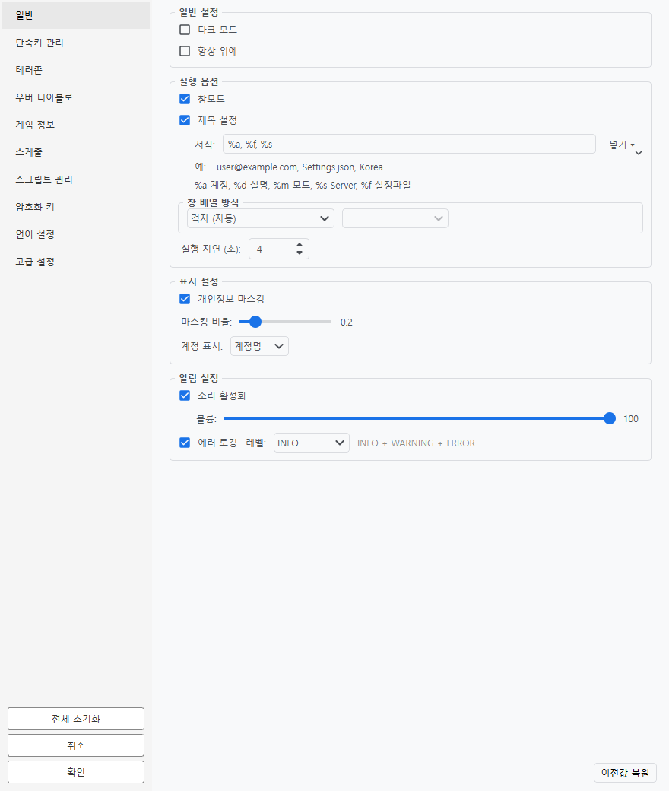
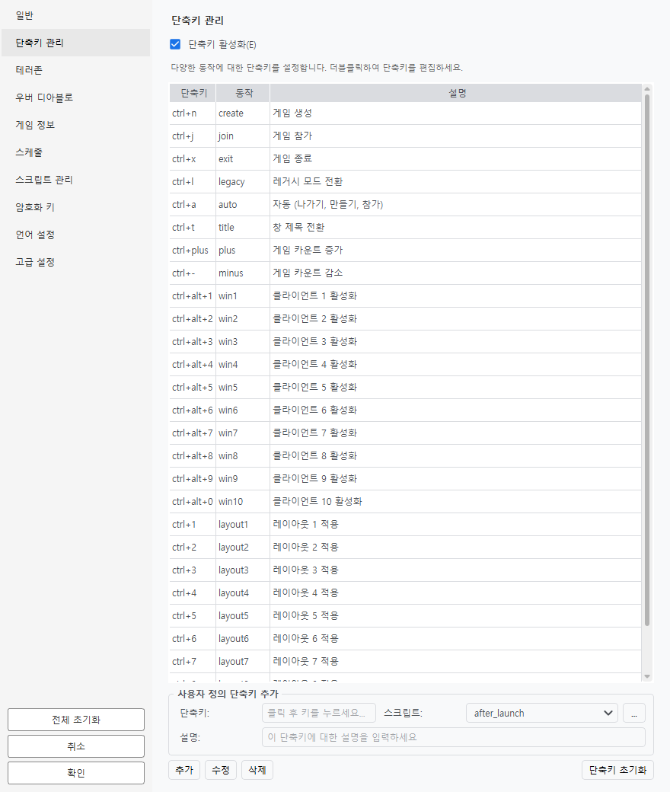
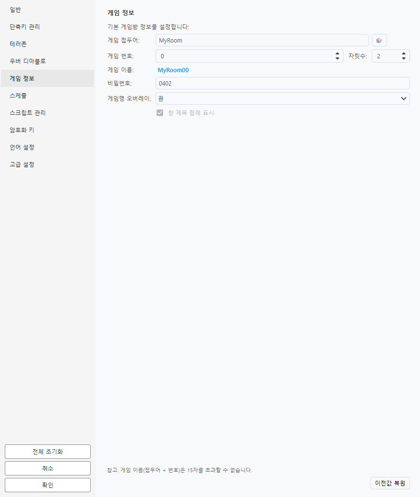
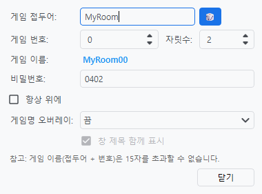
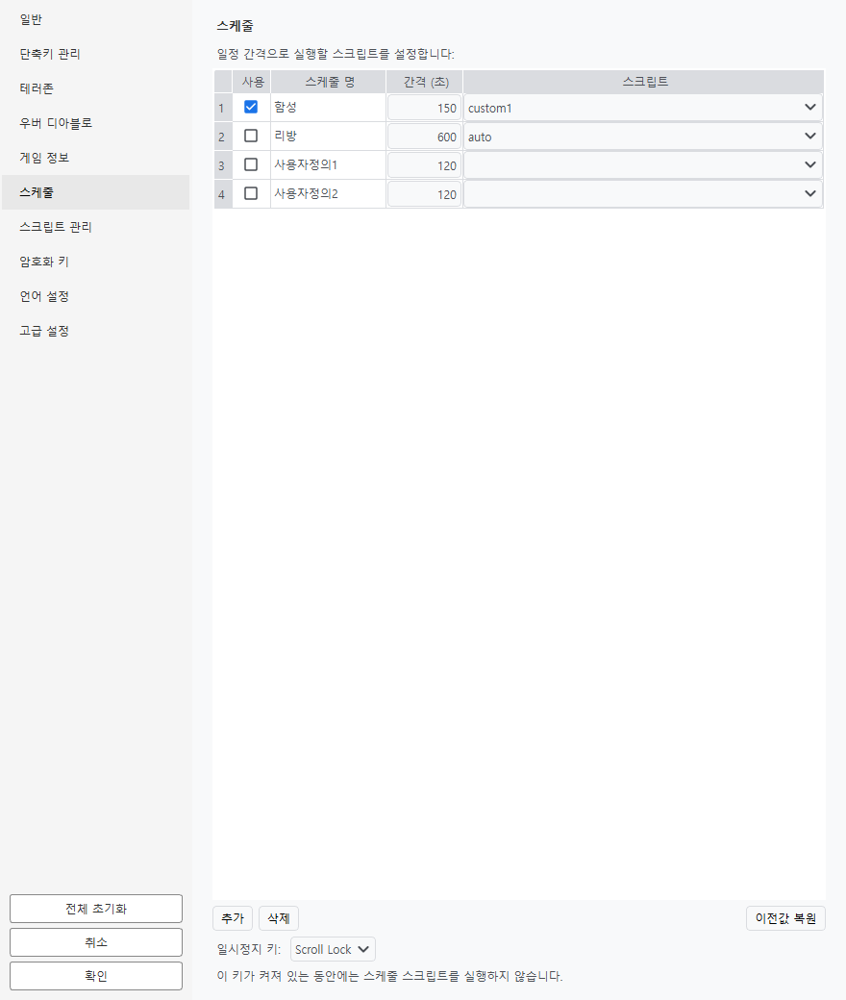
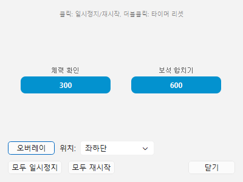
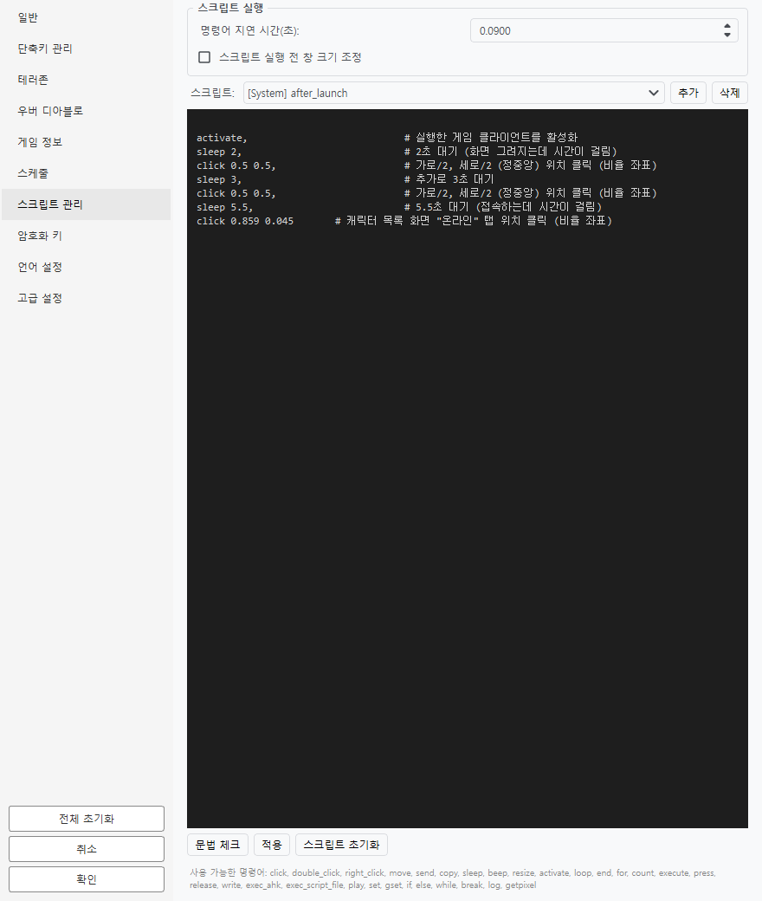
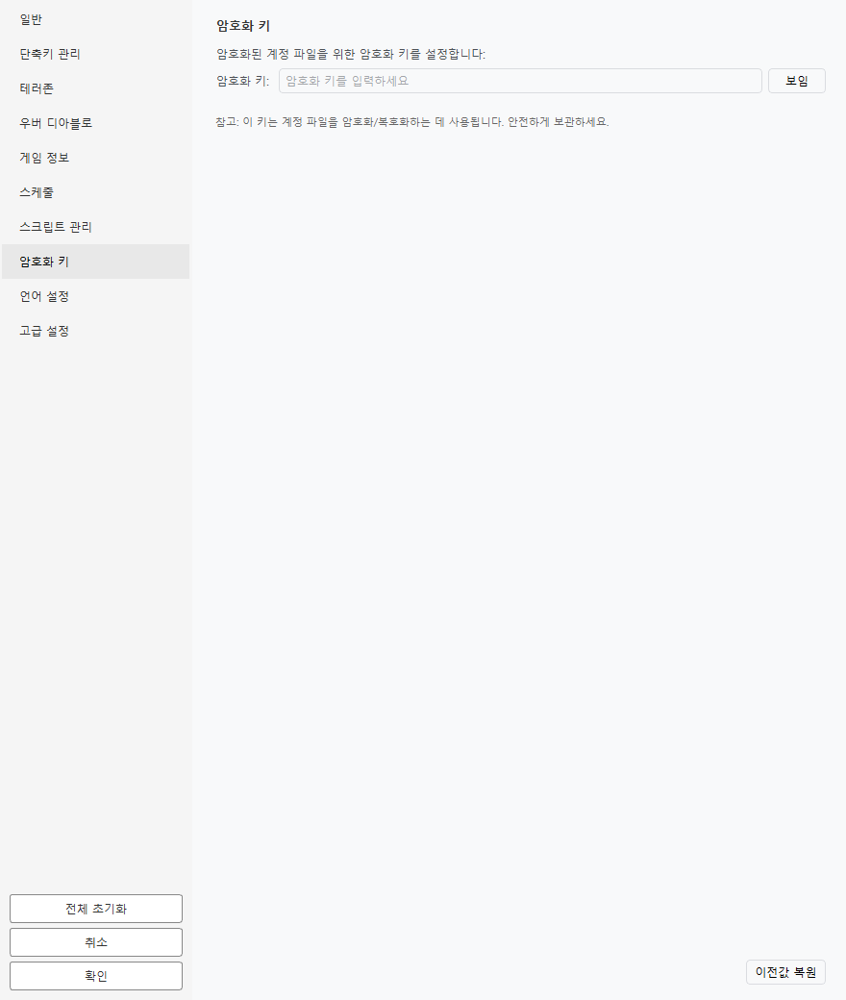
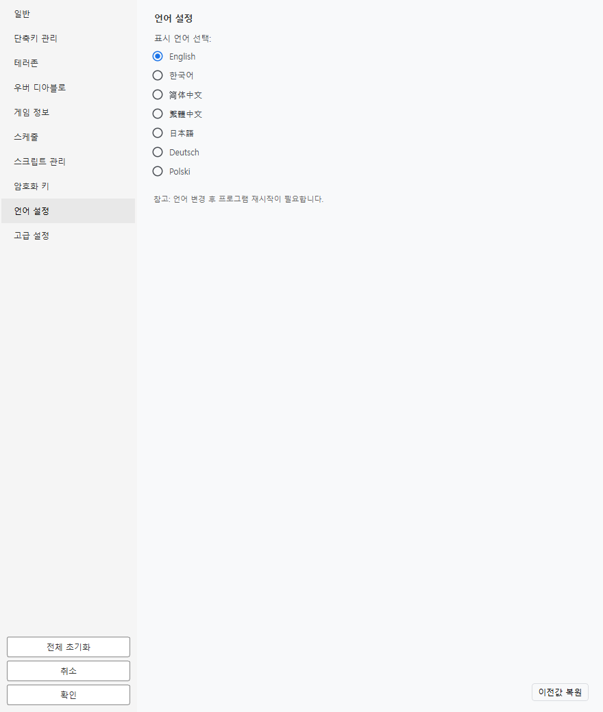

# 환경설정

**환경설정 > 환경설정 변경...** 메뉴에서 엽니다. 왼쪽에 카테고리 목록이 있고, 고른 카테고리의 설정이 오른쪽에 나옵니다.

| 카테고리 | 무엇을 설정하는가 |
|----------|-------------------|
| 일반 | 테마, 실행 옵션, 창 배열, 표시·알림 |
| 단축키 관리 | 전역 단축키 할당 |
| 테러존 | 공포의 영역 추적·알림 |
| 우버 디아블로 | 우버 디아블로(DClone) 알림 단계 |
| 게임 정보 | 방 제목·번호·비밀번호, 게임명 오버레이 |
| 스케줄 | 반복 작업과 일시정지 키 |
| 스크립트 관리 | 스크립트 편집·추가·삭제 |
| 암호화 키 | 계정 파일(`*.dat`) 암호화 키 변경 |
| 언어 설정 | 표시 언어 |
| 고급 설정 | 토큰 생성, 런처 대기, 서버 목록, 백엔드 API 서버 |

아래쪽 세 버튼은 각각 **전체 초기화**(모든 설정을 기본값으로), **취소**, **확인**입니다. 오른쪽 아래의 **이전값 복원**은 **지금 보고 있는 카테고리만** 창을 열었을 때의 값으로 되돌립니다.

!!! note "저장 시점"
    **확인**을 눌러야 저장됩니다. **취소**로 닫으면 아무것도 바뀌지 않습니다.

---

## 일반

### 일반 설정

| 항목 | 설명 | 기본값 |
|------|------|--------|
| 다크 모드 | 어두운 테마로 바꿉니다 | 꺼짐 |
| 항상 위에 | 프로그램 창을 다른 창 위에 고정합니다 | 꺼짐 |

!!! note "다크 모드와 타이틀바"
    윈도우 타이틀바는 OS가 그리므로, 이미 떠 있는 일부 창은 다시 열어야 색이 바뀝니다.

### 실행 옵션

| 항목 | 설명 | 기본값 |
|------|------|--------|
| 창모드 | D2R을 창 모드로 실행합니다 | 켜짐 |
| 제목 설정 | 게임 창 제목을 아래 서식대로 바꿉니다 | 켜짐 |
| 서식 | 창 제목에 넣을 내용 | `%a, %f, %s` |
| 창 배열 방식 | 실행 후 창을 어떻게 놓을지 | 격자 (자동) |
| 실행 지연 | 여러 클라이언트를 연속 실행할 때의 간격(초) | 4 |

창 제목 서식에 쓰는 기호:

| 기호 | 내용 |
|:----:|------|
| `%a` | 계정(사용자) |
| `%d` | 설명 |
| `%m` | 모드 |
| `%s` | 서버 |
| `%f` | 설정 파일 |

**창 배열 방식**은 다음 중에서 고릅니다.

| 방식 | 설명 |
|------|------|
| 없음 (수동) | 옮기지 않습니다 |
| 격자 (자동) | 창 개수에 맞춰 알아서 나눕니다 |
| 격자 (2열 2행) / (3열 2행) / (3열 3행) | 정해진 칸으로 나눕니다 |
| 계단식 | 조금씩 겹쳐 쌓습니다 |
| 레이아웃 적용 | **화면배치(레이아웃) 관리자**에서 만든 배치를 씁니다 |
| 계정에 저장된 실행 후 창 위치 | 계정마다 저장해 둔 위치로 옮깁니다 |

!!! tip "쓸 값이 없는 방식은 고를 수 없습니다"
    화면영역을 하나도 만들지 않았으면 '레이아웃 적용'이, 저장된 창 위치가 없으면 '계정에 저장된 실행 후 창 위치'가 비활성으로 나옵니다. 골라 놓고 아무 창도 안 움직이면 고장으로 보이기 때문입니다.

### 표시 설정

| 항목 | 설명 | 기본값 |
|------|------|--------|
| 개인정보 마스킹 | 계정 목록의 사용자 이름을 가립니다 | 켜짐 |
| 마스킹 비율 | 얼마나 보여 줄지 (0.0 ~ 1.0) | 0.2 |
| 계정 표시 방식 | 목록에 **사용자**를 보여 줄지 **설명**을 보여 줄지 | 사용자 |

### 알림 설정

| 항목 | 설명 | 기본값 |
|------|------|--------|
| 소리 알림 | 시작·오류·스크립트 단계·종료에 소리를 냅니다 | 켜짐 |
| 소리 크기 | 0 ~ 100 | 100 |
| 로그 활성화 | 로그를 파일에 남깁니다 | 켜짐 |
| 로그 수준 | DEBUG / INFO / WARNING / ERROR | INFO |

!!! tip "문제를 알아볼 때"
    로그 수준을 **DEBUG**로 내리면 스크립트가 읽은 픽셀 좌표까지 남습니다. 평소에는 INFO로 두세요.

---

## 단축키 관리

전역 단축키를 할당합니다. 게임 창이나 이 프로그램 창이 활성화돼 있을 때 동작합니다.

- 할당할 칸을 고르고 **원하는 키 조합을 그대로 누르면** 들어갑니다.
- 이미 쓰고 있는 키를 넣으면 중복이라고 알려 줍니다.
- **설명**을 적어 두면 설정을 내보낼 때 함께 나갑니다.

!!! note "Caps Lock이 켜져 있어도 동작합니다"
    키 이름이 달라져도 스캔코드로 한 번 더 확인하므로 `a`와 `A`를 같은 키로 봅니다.

---

## 테러존 · 우버 디아블로

각각 [공포의 영역](../features/terror-zone.md)과 [우버 디아블로](../features/uber-tracker.md) 문서를 참고하세요.

---

## 게임 정보

게임방을 만들 때 쓰는 값입니다.

!!! tip "게임 중에는 **도구 > 게임 정보** 창이 편합니다"
    

    같은 값을 고치는 창인데 **띄워 둔 채로** 쓸 수 있습니다. 방을 자주 바꾼다면 환경설정을 열었다 닫기를 반복할 필요가 없습니다. 툴바에도 기본으로 들어 있습니다.

| 항목 | 설명 |
|------|------|
| 게임 접두어 | 방 이름 앞부분. 오른쪽 🎲 버튼으로 무작위 생성 |
| 게임 번호 | 0 ~ 99999 |
| 자릿수 | 번호를 몇 자리로 채울지 (`2`면 `7` → `07`) |
| 게임 이름 | 접두어 + 번호를 붙인 **실제로 만들어질 이름** |
| 비밀번호 | 방 비밀번호 |
| 게임명 오버레이 | 게임 화면 위에 방 이름 표시 |
| 창 제목 함께 표시 | 오버레이에 창 제목도 같이 띄울지 |

!!! warning "게임 이름은 15자까지"
    접두어와 번호를 **합쳐서** 15자입니다. 넘으면 접두어 쪽이 잘리고 미리보기가 빨간색으로 바뀝니다. 번호는 방을 구분하는 값이라 잘리지 않습니다.

    **한글도 15자**입니다. 게임이 유니코드로 받기 때문에 영문과 같습니다.

### 게임명 오버레이

클라이언트를 여럿 띄워 두면 창을 옮긴 뒤 지금 어느 방인지 헷갈립니다. 게임 창 **위쪽 가운데**에 방 이름을 띄워 그것만 알려 줍니다.

| 표시 방식 | 설명 |
|-----------|------|
| 끔 | 띄우지 않습니다 (기본값) |
| 전환할 때만 | 그 창을 앞으로 가져온 순간 잠깐 떴다 흐려지며 사라집니다 |
| 항상 | 게임 창이 앞에 있는 동안 계속 떠 있습니다 (조금 더 옅게) |

**창 제목 함께 표시**를 켜면 `창 제목 · 방 이름` 한 줄로 나옵니다. 창 제목에는 어느 계정·설정 파일·서버인지가 들어 있어 클라이언트가 여럿일 때 구분이 됩니다. 끄면 방 이름만 나옵니다.

- 글자 크기는 **게임 창 높이에 비례**합니다. 창을 네 개로 타일 배치해도 글자가 화면을 덮지 않습니다.
- 글이 길면 자르기 전에 **글자를 먼저 줄입니다**. 그래도 안 들어가면 가운데를 `…`로 줄이고 방 이름은 끝에 남깁니다.
- 클릭은 그대로 게임으로 통과하므로 오버레이 때문에 이동·스킬이 막히지 않습니다.

!!! note "창 모드에서만 보입니다"
    DirectX 전체화면에서는 표시되지 않습니다. 창 모드나 테두리 없는 창 모드를 쓰세요.

---

## 스케줄

정해진 간격마다 스크립트를 반복 실행합니다. 진행 상황은 **도구 > 스케줄 대시보드**에서 봅니다.

도넛 하나가 스케줄 하나입니다. **클릭하면 일시정지/재시작**, **더블클릭하면 처음부터 다시** 셉니다. 게임 위에 겹쳐 띄울 수도 있습니다(반투명 오버레이, 위치 8곳).

**일시정지 토글 키**로 스케줄을 잠시 멈출 수 있습니다.

| 값 | 설명 |
|----|------|
| 없음 | 토글 키를 쓰지 않습니다 |
| Scroll Lock | 기본값 |
| Num Lock | |
| Caps Lock | |

!!! tip "Caps Lock이 기본값이 아닌 이유"
    게임 중에는 Shift 옆이라 오타로 자주 눌립니다. 그래서 Scroll Lock을 기본값으로 두었습니다.

---

## 스크립트 관리

스크립트를 추가·수정·삭제합니다. 문법은 [스크립트](../features/script.md) 문서를 참고하세요.

- 편집 중 문법 오류가 있으면 **줄 번호와 함께** 알려 줍니다.
- `create`, `join`, `exit`, `auto` 처럼 프로그램이 쓰는 **예약 스크립트는 삭제할 수 없습니다**(내용은 고칠 수 있습니다).

!!! note "기본 스크립트가 개선되면"
    프로그램을 새로 받았을 때, **직접 고치지 않은** 기본 스크립트는 새 버전으로 올라갑니다. 고쳐서 쓰던 스크립트는 그대로 두고 로그로 알려 줍니다(그 스크립트에는 개선이 들어가지 않습니다).

---

## 암호화 키

계정 파일(`*.dat`)을 암호화하는 키를 바꿉니다.

!!! warning "바꾸기 전에"
    키를 바꾸면 **이전 키로 암호화한 파일을 읽을 수 없습니다.** 바꾼 뒤에는 계정 파일을 다시 저장하세요.

---

## 언어 설정

지원 언어: English · 한국어 · 简体中文 · 繁體中文 · 日本語 · Deutsch · Polski

---

## 고급 설정

[고급 설정](advanced.md) 문서를 참고하세요.

---

## 설정 내보내기 / 가져오기

**환경설정** 메뉴에 있습니다.

| 메뉴 | 설명 |
|------|------|
| 현재 설정을 파일로 저장 | 설정을 `d2r.ini` 파일로 내보냅니다 |
| 파일에서 설정 읽기 | `d2r.ini` 파일에서 설정을 가져옵니다 |

내보낸 파일에는 설정값·서버 목록·단축키·스케줄·스크립트·화면배치가 들어갑니다. **계정 정보는 들어가지 않습니다**(계정은 `*.dat` 파일에 따로 보관합니다).

!!! note "이 PC에만 해당하는 값은 빠집니다"
    창 위치·크기, 최근 연 파일, 설치한 모드 목록, 한 번 내린 동의(브라우저 쿠키·명령줄 안내)는 내보내지 않습니다. 다른 PC로 옮겼을 때 의미가 없거나, 모르는 사이에 동의한 것이 되면 안 되기 때문입니다.

!!! tip "가져오기는 한꺼번에 적용됩니다"
    파일을 전부 읽어 본 뒤에 적용하므로, 중간에 잘못된 값이 있어도 **절반만 바뀐 상태**가 되지 않습니다. 가져온 설정은 바로 저장되므로 다시 시작해도 남아 있습니다.
